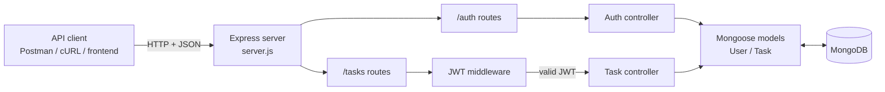
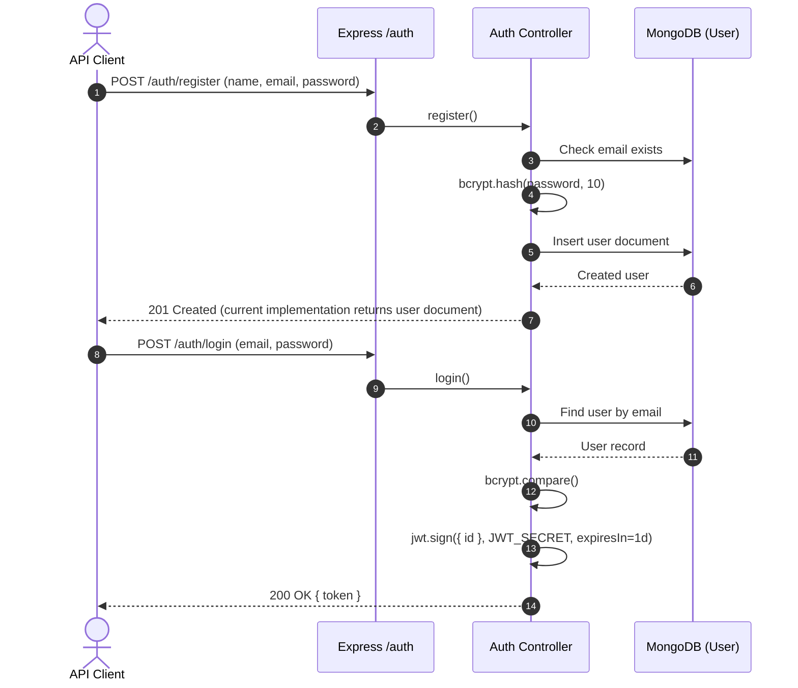
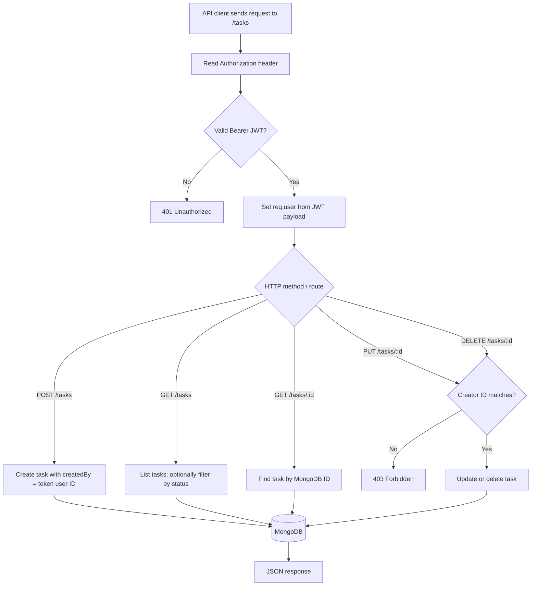
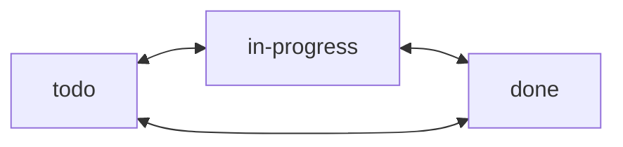
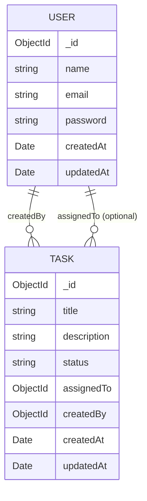

<div align="center">

# 📋 Team Task Manager API

### JWT-secured REST API for user authentication and task management

A backend-focused project built with **Node.js, Express, MongoDB, and Mongoose** to demonstrate authentication, task lifecycle management, ownership checks, and modular REST API design.

**Originally built as a Backend Developer Intern screening assignment.**


[**Quick Start**](#-quick-start) · [**Architecture**](#-system-architecture) · [**API Reference**](#-api-reference) · [**Workflows**](#-how-it-works) · [**Postman**](#-testing-with-postman)

</div>

> [!IMPORTANT]
> **API-only repository.** This project contains an Express REST API, not a web dashboard or mobile application. It is a learning/portfolio prototype; review the [security and known limitations](#-security-and-known-limitations) before exposing it to real users.

---

## 🎯 Overview

The **Team Task Manager API** provides account registration and login, issues JSON Web Tokens for authentication, and stores tasks in MongoDB. Authenticated clients can create tasks, retrieve tasks, filter by status, and update or delete tasks subject to a creator check.

The backend is organized into **routes → middleware → controllers → Mongoose models**, keeping HTTP routing, authentication, business logic, and database access in distinct modules.

### ✨ Implemented capabilities

| Capability | Behavior in the current code |
| --- | --- |
| 👤 User registration | Creates users with a name, unique email, and bcrypt-hashed password (cost factor 10). |
| 🔑 User login | Verifies credentials and returns a signed JWT that expires in **1 day**. |
| 🛡️ Protected task endpoints | Middleware validates a `Bearer` JWT before task requests reach their controllers. |
| 📝 Task management | Create, retrieve, update, and delete tasks persisted through Mongoose. |
| 🧩 Task assignment field | A task may reference another user using the optional `assignedTo` ObjectId; no assignment workflow/notification logic is implemented. |
| 🚦 Task status tracking | `todo`, `in-progress`, or `done`; `todo` is the default. |
| 🔎 Status filtering | `GET /tasks?status=todo` filters tasks by status. |
| 👥 Creator checks | `PUT` and `DELETE` compare the task's `createdBy` ID with the authenticated user ID. See [limitations](#-security-and-known-limitations). |

---

## 🧰 Technology stack

| Layer | Technology | Role |
| --- | --- | --- |
| Runtime | Node.js | Executes the backend JavaScript application. |
| HTTP framework | Express 5 | Routes, middleware, request handling, and JSON responses. |
| Database | MongoDB | Persists users and tasks. |
| ODM | Mongoose 9 | Schemas, validation rules, and MongoDB queries. |
| Authentication | `jsonwebtoken` | Creates and verifies signed JWTs. |
| Password hashing | `bcryptjs` | Hashes and checks account passwords. |
| Configuration | `dotenv` | Loads environment variables from `.env`. |
| Cross-origin requests | `cors` | Enables CORS (unrestricted origins in the current code). |
| Development | `nodemon` | Restarts the server during development. |
| Manual API testing | Postman / cURL | Sends requests and inspects HTTP responses. |

> The dependency versions are defined by `package.json` and locked by `package-lock.json`. The repository does **not** include a frontend, automated test suite, Docker configuration, or a deployed API URL.

---

## 🏗️ System architecture



**Responsibility breakdown**

1. **Routes** map incoming HTTP requests to the appropriate controller.
2. **Authentication middleware** reads and verifies the JWT on every `/tasks` route.
3. **Controllers** perform registration, login, task CRUD, and the current creator-ownership checks.
4. **Mongoose models** define the document fields and constraints used to read/write MongoDB.

---

## 🔄 How it works

### Workflow 1 — Register, log in, and receive a JWT



**Note:** The existing registration handler returns the stored user document, including its **password hash**. The hash is not the plaintext password, but should still be excluded from API responses before production use.

### Workflow 2 — Authenticated task lifecycle



**Important access-scope detail:** As currently implemented, authenticated `GET /tasks` and `GET /tasks/:id` queries are **not limited to tasks created by the requesting user**. They can return other users' tasks. Likewise, `PUT` accepts arbitrary request-body fields, including `createdBy`, which weakens the intended ownership model. These are documented implementation gaps, not production-ready access control.

### Task status lifecycle

A task starts with `todo` unless a valid status is supplied. Clients may update its status to any of the three allowed values; **there is no enforced transition order**.



---

## 🗃️ Data models



### User (`models/User.js`)

| Field | Type | Validation / behavior |
| --- | --- | --- |
| `name` | String | Required |
| `email` | String | Required, unique index |
| `password` | String | Required; registration handler hashes with bcryptjs |
| `createdAt`, `updatedAt` | Date | Added automatically by Mongoose timestamps |

### Task (`models/Task.js`)

| Field | Type | Validation / behavior |
| --- | --- | --- |
| `title` | String | Required |
| `description` | String | Optional |
| `status` | String | `todo` / `in-progress` / `done`; defaults to `todo` |
| `assignedTo` | ObjectId → User | Optional reference; not independently validated as an existing user |
| `createdBy` | ObjectId → User | Set to JWT user ID on create; editable by the current update controller |
| `createdAt`, `updatedAt` | Date | Added automatically by Mongoose timestamps |

---

## 🚀 Quick start

### Prerequisites

- **Node.js and npm** installed on your computer.
- A running **MongoDB** instance, local or hosted (for example, MongoDB Atlas).
- **Postman** or another HTTP client for testing the endpoints.

### 1. Download the source

Clone your published repository (replace the URL if your repository name differs):

```bash
git clone https://github.com/Abhii26/collabzz-task-manager.git
cd collabzz-task-manager
```

Alternatively, extract the downloaded project ZIP and open a terminal in the folder containing `package.json`.

### 2. Install dependencies

```bash
npm install
```

### 3. Configure environment variables

Create a `.env` file **in the project root**, next to `server.js`:

```dotenv
PORT=5000
MONGO_URI=mongodb://127.0.0.1:27017/team-task-manager
JWT_SECRET=replace_with_a_long_random_secret
```

| Variable | Required | Purpose |
| --- | --- | --- |
| `PORT` | No | HTTP port; defaults to `5000` in `server.js`. |
| `MONGO_URI` | Yes | MongoDB connection string read by `config/db.js`. |
| `JWT_SECRET` | Yes | Secret used to sign and verify JWTs. |

> Keep `.env` private. It is excluded by the existing `.gitignore`. When using a hosted MongoDB service, replace `MONGO_URI` with its connection string. Never commit database credentials or JWT secrets.

### 4. Start the API

For development with automatic restarts:

```bash
npm run dev
```

For a regular Node process:

```bash
npm start
```

Expected startup logs (assuming MongoDB is reachable):

```text
Server running on port 5000
MongoDB Connected
```

**Base URL:** `http://localhost:5000`

The application has **no `GET /` landing page or health-check endpoint**, so opening the base URL in a browser is not a useful functionality test. Use the API routes below.

---

## 📡 API reference

### Endpoint summary

| Method | Endpoint | JWT needed? | Purpose |
| --- | --- | :---: | --- |
| `POST` | `/auth/register` | No | Create an account |
| `POST` | `/auth/login` | No | Receive a JWT |
| `POST` | `/tasks` | Yes | Create a task |
| `GET` | `/tasks` | Yes | List all tasks visible to the current implementation |
| `GET` | `/tasks?status=todo` | Yes | Filter tasks by status |
| `GET` | `/tasks/:id` | Yes | Get a task by ObjectId |
| `PUT` | `/tasks/:id` | Yes | Update a task after creator check |
| `DELETE` | `/tasks/:id` | Yes | Delete a task after creator check |

All requests and responses use JSON. For protected routes, pass:

```http
Authorization: Bearer YOUR_JWT_TOKEN
Content-Type: application/json
```

### 1. Register a user

`POST /auth/register`

```json
{
  "name": "Demo User",
  "email": "demo@example.com",
  "password": "replace-with-a-secure-password"
}
```

**Current responses:** `201 Created` with a user document (currently **including the hashed password**); `400` if the email already exists. Missing/invalid fields can surface as a `500` due to the controller's current error handling.

### 2. Log in

`POST /auth/login`

```json
{
  "email": "demo@example.com",
  "password": "replace-with-a-secure-password"
}
```

**Successful response — `200 OK`:**

```json
{
  "token": "YOUR_SIGNED_JWT_TOKEN"
}
```

Invalid credentials return `400` with `{"message":"Invalid credentials"}`. The JWT is signed with an **expiration of 1 day**.

### 3. Create a task

`POST /tasks` — requires JWT.

```json
{
  "title": "Implement authentication",
  "description": "Add JWT login to the backend",
  "status": "todo"
}
```

**Successful response:** `201 Created` with the saved task, including an `_id`, `createdBy`, and timestamps. The server sets `createdBy` using the JWT user ID.

An optional `assignedTo` field may contain a valid MongoDB user ObjectId:

```json
{
  "title": "Review endpoint contracts",
  "assignedTo": "507f1f77bcf86cd799439011"
}
```

This only records a reference; it **does not** send an invitation or notification.

### 4. List / filter tasks

`GET /tasks`

`GET /tasks?status=in-progress`

**Successful response:** `200 OK` with a JSON array. The current database query is `Task.find(filter)` and does **not** scope results to the logged-in user.

### 5. Get a task by ID

`GET /tasks/:id`

**Successful response:** `200 OK` with a task document; if no task matches, the current handler returns JSON `null` rather than a `404` response.

### 6. Update a task

`PUT /tasks/:id` — requires JWT and a matching creator ID.

```json
{
  "title": "Complete authentication and authorization",
  "status": "in-progress"
}
```

**Successful response:** `200 OK` with the saved task. A non-creator receives `403` and `{"message":"Not allowed"}`. The current implementation does **not** restrict which task fields may be updated: see [security notes](#-security-and-known-limitations).

### 7. Delete a task

`DELETE /tasks/:id` — requires JWT and a matching creator ID.

**Successful response:** `200 OK`:

```json
{
  "message": "Task deleted"
}
```

A non-creator receives `403`. Missing or malformed task IDs are **not consistently translated into `404`/`400` responses** in the current controllers.

### Relevant HTTP outcomes

| Status | Where it currently occurs |
| --- | --- |
| `200` | Login, reads, successful update, successful deletion |
| `201` | Successful registration or task creation |
| `400` | Duplicate registered email; invalid login credentials |
| `401` | Missing or invalid task-route token |
| `403` | Task modification/deletion by a non-creator |
| `500` | Some failures in registration or task creation; other errors may reach Express's default handler |

> These are **observed code paths**, not a standardized error contract. The app has no dedicated central error handler.

---

## 🧪 Testing with Postman

The original project documentation supplies a [Postman collection link](https://web.postman.co/workspace/new-postman~27d6ecd4-b82d-4eb9-9225-83b24acbd208/collection/42487126-299bff02-9994-40e8-809f-1c9ffa0c7816?action=share&source=copy-link&creator=42487126). Access may depend on the collection's sharing settings.

**Recommended manual test flow:**

1. Send `POST /auth/register` with a sample user.
2. Send `POST /auth/login` and copy the returned token.
3. In Postman, choose **Authorization → Bearer Token** for task requests and paste the token.
4. Create a task via `POST /tasks`; copy its `_id` from the response.
5. List tasks with `GET /tasks` and filter with `GET /tasks?status=todo`.
6. Update that task using `PUT /tasks/:id`; then delete it using `DELETE /tasks/:id`.
7. Verify negative cases: missing JWT (`401`), invalid JWT (`401`), and non-creator modification (`403`).

### cURL example

```bash
# Replace credentials and token values for your local test.
BASE_URL="http://localhost:5000"

curl -X POST "$BASE_URL/auth/register" \
  -H "Content-Type: application/json" \
  -d '{"name":"Demo User","email":"demo@example.com","password":"change-this-password"}'

curl -X POST "$BASE_URL/auth/login" \
  -H "Content-Type: application/json" \
  -d '{"email":"demo@example.com","password":"change-this-password"}'

# Copy the token from the login response.
TOKEN="PASTE_YOUR_JWT_HERE"

curl -X POST "$BASE_URL/tasks" \
  -H "Authorization: Bearer $TOKEN" \
  -H "Content-Type: application/json" \
  -d '{"title":"Build task API","status":"todo"}'

curl -H "Authorization: Bearer $TOKEN" \
  "$BASE_URL/tasks?status=todo"
```

**Automated tests:** The `npm test` command is currently a placeholder and exits with an error. There is no Jest, Supertest, or other automated test suite configured in the supplied project.

---

## 🗂️ Project structure

```text
collabzz-task-manager/
├── config/
│   └── db.js                     # MongoDB connection
├── controllers/
│   ├── authController.js         # Registration and JWT login
│   └── taskController.js         # Task creation, reads, update, delete
├── middleware/
│   └── authMiddleware.js         # JWT validation for task routes
├── models/
│   ├── Task.js                   # Task schema and status enum
│   └── User.js                   # User schema
├── routes/
│   ├── authRoutes.js             # /auth/register, /auth/login
│   └── taskRoutes.js             # Authenticated /tasks endpoints
├── .gitignore                    # Excludes node_modules and .env
├── package.json                  # Scripts and dependencies
├── package-lock.json             # Locked dependency tree
├── server.js                     # Express app and route mounting
└── README.md                     # Documentation
```

---

## 🔐 Security and known limitations

The code demonstrates useful backend concepts, but is **not ready for public production deployment** without additional controls.

| Area | Current behavior | Recommended improvement |
| --- | --- | --- |
| **User data exposure** | Registration responds with the full user document, including the password hash. | Return an explicit safe response DTO (`id`, `name`, `email`); always exclude the hash. |
| **Task read authorization** | An authenticated user can list and read other users' tasks. | Define the product's access policy and apply `createdBy`/membership-based query filters. |
| **Task ownership integrity** | `PUT /tasks/:id` merges arbitrary body fields, including `createdBy`. | Allowlist editable fields; make creator ownership immutable. |
| **Missing task handling** | Update/delete can throw when the task doesn't exist; reads may return `null`. | Validate ObjectIds; return explicit `400`/`404` with a consistent JSON error format. |
| **Input validation** | Primarily relies on Mongoose schema constraints; several validation failures surface as `500`. | Validate request bodies, types, lengths, status values, and credentials at the API boundary. |
| **JWT lifecycle** | Signed tokens expire in one day; no refresh, revocation, or logout endpoints. | Add token lifecycle features if required by the product. |
| **Abuse protection** | No rate limiting; CORS currently allows all origins. | Add rate limiting, safer CORS settings, security headers, and request size controls. |
| **Assignee handling** | `assignedTo` is an optional user ID only. | Validate users and define team membership/assignment permissions. |
| **Operations** | No centralized errors, monitoring, health checks, or automated tests. | Add logging, health endpoint, CI tests, and monitoring. |

**Protect `.env`**, use a strong secret, connect over TLS in production, and avoid sharing any real credentials or JWTs in issues/screenshots.

---

## ☁️ Deployment considerations

The application runs as a long-lived Node.js server and needs a reachable MongoDB database. For a production-style deployment:

1. Choose a hosting provider that runs **Node.js server processes** (not static-only hosting).
2. Provision MongoDB or a compatible managed MongoDB service.
3. Add `MONGO_URI` and `JWT_SECRET` as environment variables; let the provider set `PORT` when applicable.
4. Configure the start command as `npm start` and make the deployment publicly reachable via HTTPS.
5. **Fix the security issues above before exposing the API to real users.**

There is no verified public live API URL in the supplied project, so this README intentionally does not claim a live deployment.

---

## 🗺️ Roadmap

- [ ] Enforce per-user/team task visibility and immutable ownership.
- [ ] Remove password hashes from responses and add consistent validation/error handling.
- [ ] Add integration tests for authentication, task CRUD, and unauthorized access.
- [ ] Validate assignment targets and add team-level authorization rules.
- [ ] Add pagination, sorting, and richer task filters.
- [ ] Add refresh/logout strategy and API rate limiting.
- [ ] Publish an OpenAPI / Swagger specification and importable Postman collection.
- [ ] Add CI, health checks, structured logging, and deployment configuration.
- [ ] Optionally build a frontend dashboard for team workflows.

---

## 🤝 Contributing

Suggestions, bug reports, and pull requests are welcome. For code changes, create a branch, keep commits focused, describe the behavior being changed, and include tests where possible. Please do not put real secrets, JWTs, or personal data into issues or pull requests.

## 📄 License

`package.json` currently declares **ISC**, while the previous README mentioned MIT. The supplied archive does **not** include a standalone `LICENSE` file. Confirm the intended license and add the corresponding license text before claiming a different license.

## 👨‍💻 Author

**Abhishek Tiwari**  
[GitHub Profile](https://github.com/Abhii26)

---

<div align="center">

**Built to demonstrate REST APIs, JWT authentication, MongoDB data modeling, and backend engineering fundamentals.**

</div>
